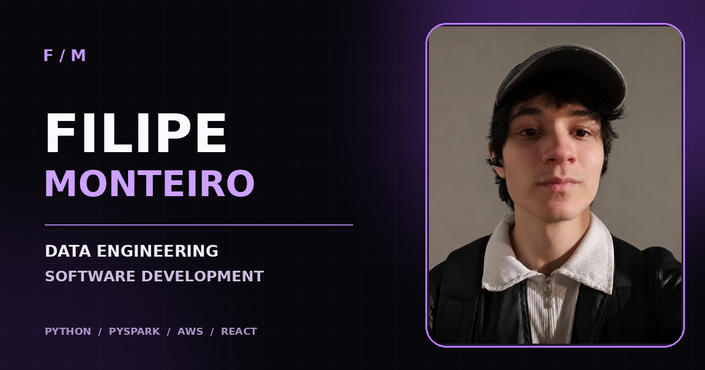
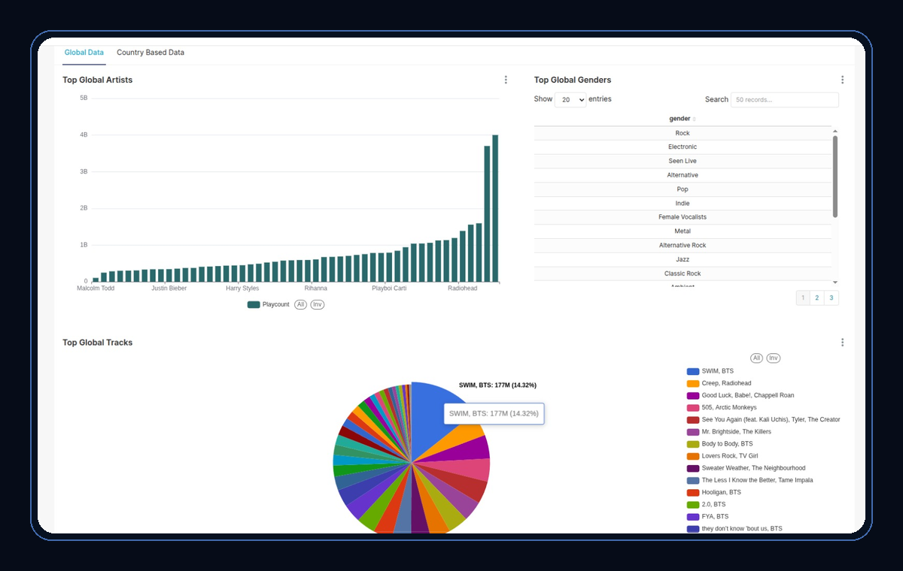
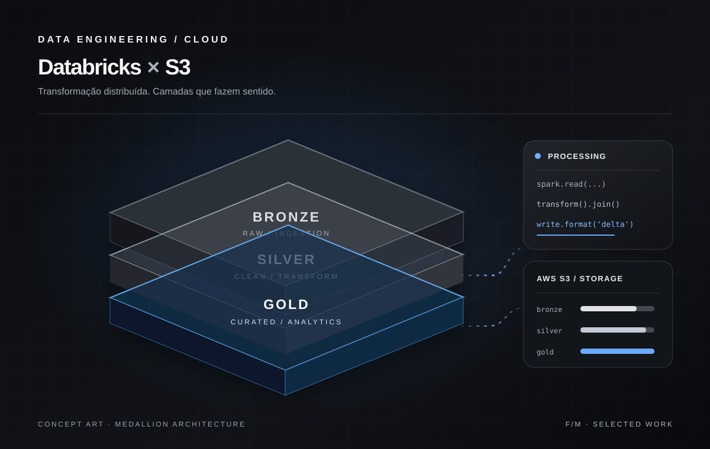
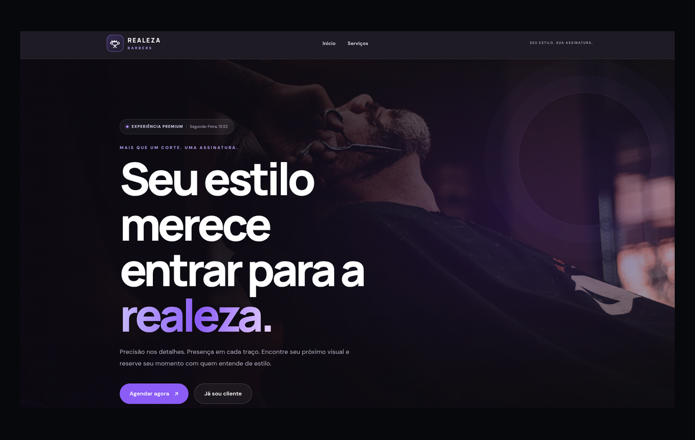
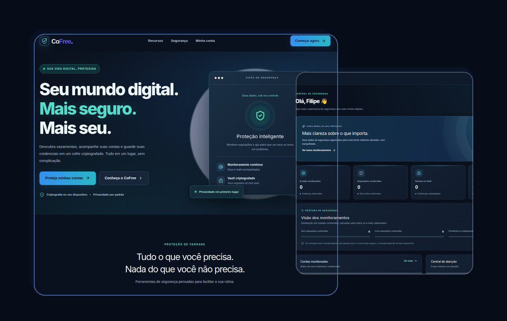

# FILIPE MONTEIRO

### Portfólio pessoal · Engenharia de Dados & Desenvolvimento Full Stack

**Dados, software e design conectados para transformar ideias em soluções reais.**

 

 

[**GitHub**](https://github.com/filipemtr) · [**LinkedIn**](https://www.linkedin.com/in/filipemonteiro11) · [**Contato**](mailto:filipemtr11@gmail.com)

---

## Sobre o projeto

Este portfólio foi criado para ir além de uma apresentação tradicional de currículo. Ele reúne **minha trajetória, competências técnicas e projetos práticos** em uma experiência visual que combina identidade pessoal, interatividade e uma navegação intuitiva.

O foco está em duas áreas que se complementam: **Engenharia de Dados**, com pipelines, processamento distribuído e soluções em nuvem, e **Desenvolvimento de Software**, com aplicações web, APIs e arquitetura de sistemas.

## Identidade visual

Uma interface **dark-first**, construída com uma paleta de **preto, roxo ametista e branco**, valorizando contraste, legibilidade e profundidade.

- **Glassmorphism:** painéis translúcidos, bordas sutis e camadas com efeito de vidro.
- **Identidade pessoal:** fotografias integradas à composição e tipografia de destaque.
- **Microinterações:** animações de entrada, transições e feedbacks visuais.
- **Elementos gráficos:** órbitas, conexões, halos e referências a sistemas e dados.
- **Responsividade:** layouts adaptados para desktop, tablet e dispositivos móveis.

## Experiência e funcionalidades

| Experiência | O que apresenta |
| :--- | :--- |
| **Hero personalizado** | Introdução profissional com fotografia, identidade visual e acesso rápido às principais seções. |
| **Mapa interativo de tecnologias** | Exploração visual de competências e ferramentas do meu ecossistema técnico. |
| **Projetos em destaque** | Cards com imagens, descrições, tecnologias e acesso aos repositórios. |
| **Estudos de caso** | Páginas dedicadas a objetivos, decisões técnicas, desafios e aprendizados. |
| **Filtros de projetos** | Navegação por áreas de atuação e tipos de solução. |
| **Terminal demonstrativo** | Uma interação temática que reforça a proposta tecnológica do site. |
| **Contato direto** | Links para GitHub, LinkedIn e e-mail. |

## Projetos apresentados

### 01 · LastFM Tracker

Pipeline de Engenharia de Dados para explorar tendências musicais globais e por país, integrando **Python, Apache Airflow, PySpark, Databricks, AWS S3, Glue, Athena e Apache Superset**. A solução utiliza a arquitetura **Medallion** e modelagem dimensional para organizar os dados até a camada analítica.

[**Explorar repositório →**](https://github.com/filipemtr/LastFM-Tracker)

### 02 · Databricks × S3

Projeto de pipeline ETL com **Databricks, PySpark, AWS S3 e Delta Lake**, estruturado em camadas **Bronze, Silver e Gold**. A imagem é uma representação conceitual da arquitetura.

[**Explorar repositório →**](https://github.com/filipemtr/pipeline-databricks-s3)

### 03 · Realeza Barbers

Aplicação web voltada à experiência e ao gerenciamento de uma barbearia, com foco em **agendamentos, clientes, serviços e interface responsiva**. O projeto explora desenvolvimento frontend com **React, TypeScript e Tailwind CSS**.

[**Explorar repositório →**](https://github.com/filipemtr/Realeza_Barbers)

### 04 · CoFree

Plataforma acadêmica de **segurança digital e conscientização sobre vazamentos de credenciais**, combinando desenvolvimento web e backend. O projeto aborda **React, TypeScript, FastAPI, PostgreSQL, Celery, Redis** e práticas de proteção de contas. **Projeto em evolução.**

[**Explorar repositório →**](https://github.com/filipemtr/CoFree)

## Tecnologias do portfólio

| Camada | Tecnologias |
| :--- | :--- |
| **Aplicação** | Next.js · React · TypeScript |
| **Estilização** | CSS personalizado · Design responsivo · Glassmorphism |
| **Animações** | Motion · Transições CSS |
| **Interface** | Lucide Icons · Componentes reutilizáveis |
| **Estrutura** | App Router · Páginas dinâmicas de projetos |

## O propósito

Mais do que listar tecnologias, este projeto busca **mostrar como penso, construo e comunico soluções**. Cada seção foi pensada para apresentar não só o resultado visual, mas também as decisões, os desafios e os aprendizados por trás dos projetos.

---

### Vamos construir algo?

Estou aberto a conexões, oportunidades e projetos nas áreas de **Engenharia de Dados, Backend e Desenvolvimento Full Stack**.

Desenvolvido por Filipe Monteiro · Caruaru, Pernambuco

